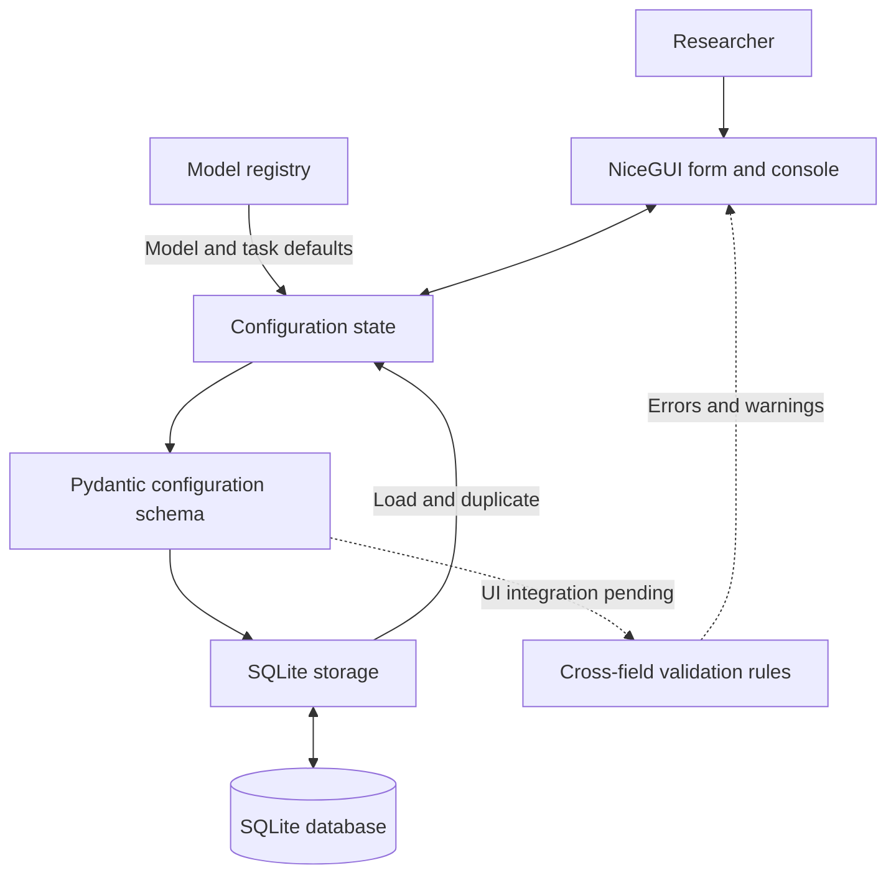

# LLM Fact-Checking Configuration Platform

A Python-based platform for configuring, validating, and storing reproducible fact-checking experiments using large language models (LLMs).

## 1. Overview

The platform organizes experiment settings for model loading, tokenization, datasets, prompts, fine-tuning, and inference. It uses Pydantic to represent configurations, NiceGUI for the web interface, and SQLite to store saved experiments.

### Supported models

| Model | Model identifier |
| --- | --- |
| Mistral Small 24B Instruct | `mistralai/Mistral-Small-24B-Instruct-2501` |
| DeepSeek R1 Distill Qwen 32B | `deepseek-ai/DeepSeek-R1-Distill-Qwen-32B` |

**Supported tasks:** `fine_tune` and `inference`.

The current platform manages experiment configurations. Running model training or inference, generating execution scripts, and analyzing experiment results are planned for later milestones.

## 2. Installation and Usage

**Requirements:** Git, Python 3.11 or newer, and the packages listed in `requirements.txt`. SQLite is included with Python and does not require a separate server.

### Windows (PowerShell)

```powershell
git clone https://github.com/Bamboorat233/4990_llm-config-platform.git
cd 4990_llm-config-platform
git switch 8-console-main
py -3 -m venv .venv
.\.venv\Scripts\python.exe -m pip install -r requirements.txt
.\.venv\Scripts\python.exe -m app.main
```

### macOS / Linux

```bash
git clone https://github.com/Bamboorat233/4990_llm-config-platform.git
cd 4990_llm-config-platform
git switch 8-console-main
python3 -m venv .venv
.venv/bin/python -m pip install -r requirements.txt
.venv/bin/python -m app.main
```

Open **http://localhost:8080** in a browser.

The NiceGUI entry point is currently on the `8-console-main` development branch; the commands above use that branch.

## 3. Architecture

The application connects a NiceGUI form to model defaults, Pydantic configuration records, and SQLite storage. Cross-field validation is implemented as a separate module; its connection to the development UI is not yet complete.



## 4. Core Components

### Model registry — `app/registry.py`

Defines the supported LLMs, their metadata, and default parameter values for each model and task combination. These defaults initialize configurations and are used when switching models or resetting the form. Merged into `main` in [PR #19](https://github.com/Bamboorat233/4990_llm-config-platform/pull/19).

### Configuration schemas — `app/schemas.py`

Uses Pydantic models to define the structure and data types of experiment settings. The `ConfigRecord` model represents a complete configuration, and fingerprinting supports identification of identical functional settings. Merged into `main` in [PR #20](https://github.com/Bamboorat233/4990_llm-config-platform/pull/20).

### Cross-field validation — `app/validation.py`

Implements ten checks for compatibility between configuration fields, including token limits, padding, sampling, fine-tuning settings, and prompt consistency. Each issue identifies a field, a severity level, and a message. The module is merged into `main` ([PR #23](https://github.com/Bamboorat233/4990_llm-config-platform/pull/23)), but the rules are not yet connected to the live UI.

### Application interface — `app/main.py`

Builds the NiceGUI form with model and task selectors, prompt and parameter inputs, and controls to save, load, duplicate, delete, or reset configurations. The development interface also updates the JSON preview as form values change. Fixes for configuration loading and model switching were merged into `8-console-main` in [PR #25](https://github.com/Bamboorat233/4990_llm-config-platform/pull/25); the UI entry point has not yet been merged into `main`.

### Validation console — `app/ui/console.py`

Provides the live JSON preview, validation status area, field-feedback utilities, and action controls. The console accepts a validation callback from the main application. Its current development integration supplies an empty issue list, so cross-field errors are not yet displayed or enforced in the UI. The console module was merged into `main` in [PR #22](https://github.com/Bamboorat233/4990_llm-config-platform/pull/22).

### Configuration storage — `app/store.py`

Stores configuration metadata and complete JSON records in SQLite. It supports saving, listing, retrieving, and duplicating configurations, with SHA-256 fingerprints used to reject identical functional settings. The default database is `data/platform.db`; its location can be overridden with `LLM_CONFIG_DB_PATH` or the `db_path` argument. The storage module was merged into `main` in [PR #24](https://github.com/Bamboorat233/4990_llm-config-platform/pull/24).

## 5. Configuration and Validation

A configuration includes model and tokenizer settings, data sources, fine-tuning options, encoding, generation, decoding, prompts, and optional arguments. The shared schema maintains these settings as one record for saving and reuse.

Configurations are compared using SHA-256 fingerprints of their functional settings. Metadata such as the configuration ID, creation time, author, notes, and run status does not affect the fingerprint. A duplicated record receives a new ID and timestamp; at least one functional setting must change before it can be saved alongside the original.

Validation results use the following format:

```json
{"field": "b.padding_side", "level": "error", "msg": "Example validation message"}
```

An `error` identifies an invalid parameter combination, while a `warning` indicates a condition that may need attention. Although the ten rules are implemented and unit-tested, **live cross-field validation is not yet wired into `app/main.py`**. Some configuration sections, including the complete fine-tuning/generation controls and optional-argument panels, also remain to be integrated into the UI.

## 6. Testing

Automated tests cover the registry, schemas, cross-field validation, console helpers, and SQLite storage. Run the test suite from the repository root:

```bash
python -m pip install pytest
python -m pytest -v
```

**Local integration testing (November 2026):** The NiceGUI development interface was tested for saving and loading configurations, rejecting duplicates, creating and saving modified copies, deleting records, and preserving saved data after an application restart. Form restoration, JSON preview updates, and model switching were also tested after the UI fixes. The local automated test suite passed.

The full UI milestone still requires integration and acceptance testing of live validation and the remaining configuration panels. The results above are local test results, not a claim of complete release acceptance.

## 7. Original Script Defects and Corrections

The project specifications identify six issues in the original experiment scripts. The configuration platform addresses some through structured fields, defaults, and validation; corrections that require generated execution scripts belong to a later milestone.

| # | Identified issue | Correction or safeguard | Status |
| --- | --- | --- | --- |
| 1 | Conditional-expression precedence can omit part of a question when no evidence is available. | Group prompt expressions explicitly and handle empty evidence lists. | Script correction planned |
| 2 | The Mistral inference script uses an invalid padding token (`<myPadToken>`). | Provide supported padding-token defaults and check token compatibility. | Registry and validation safeguards implemented; script correction pending |
| 3 | `fix_mistral_regex` is assigned after tokenizer creation. | Supply the setting during `from_pretrained()` initialization. | Configuration validation implemented; script correction pending |
| 4 | Training and evaluation scripts use inconsistent assistant/verdict prefixes. | Store the assistant prompt and verdict marker and check their consistency. | Single-record check implemented; cross-script checks pending |
| 5 | Dataset and output paths are hard-coded. | Represent paths as configurable fields for use in generated scripts. | Configuration fields implemented; script generation pending |
| 6 | The training script does not explicitly set a random seed. | Include the seed as `d.sft.seed` (default `42`). | Schema and defaults implemented; script integration pending |

See [`planning/TaskList.md`](planning/TaskList.md) and [`specs/model-reference.md`](specs/model-reference.md) for the original analysis.

## 8. Project Documentation

- [Interface contracts](specs/interfaces.md)
- [Parameter specification](specs/parameters.md)
- [Model and reference-script analysis](specs/model-reference.md)
- [System design and roadmap](design/Spec_and_roadmap.md)
- [Milestone tasks](planning/TaskList.md)
- [GitHub Issues](https://github.com/Bamboorat233/4990_llm-config-platform/issues)

