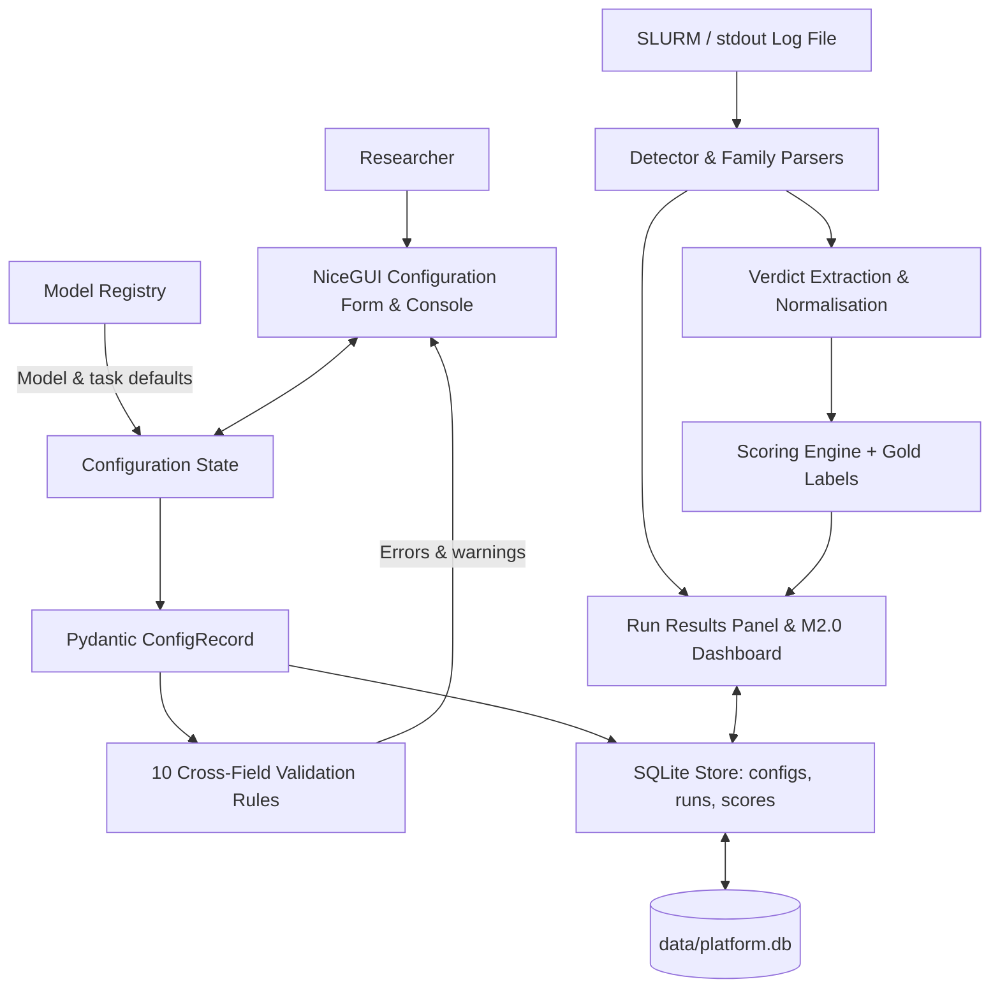

# LLM Fact-Checking Configuration Platform

A Python-based platform for configuring, validating, storing, parsing, and scoring reproducible fact-checking experiments using large language models (LLMs).

## 1. Overview

The platform covers two connected workflows:

1. **Experiment Configuration (M0.5 - M1.0):** Organizes settings for model loading, tokenization, datasets, prompts, fine-tuning, and inference with Pydantic schemas, ten live cross-field validation rules, and deduplicated SQLite persistence.
2. **Log Parsing and Evaluation (M1.5 - M2.0):** Parses SLURM and Python execution logs from HPC cluster runs, classifies run family/status/phase outcomes, extracts and normalizes inference verdicts, scores predictions against gold labels with dual exact/inclusive metrics, persists runs and scores to SQLite, and displays them in the Results dashboard.

The platform does not execute cluster jobs directly; jobs run via SLURM on the HPC cluster, and users upload or select the resulting log files in the **Run Results** tab and link them to saved configurations.

### Supported models

| Model | Model identifier |
| --- | --- |
| Mistral Small 24B Instruct | `mistralai/Mistral-Small-24B-Instruct-2501` |
| DeepSeek R1 Distill Qwen 32B | `deepseek-ai/DeepSeek-R1-Distill-Qwen-32B` |

**Supported tasks:** `fine_tune` and `inference`.

## 2. Installation and Usage

**Requirements:** Git, Python 3.11 or newer, and the packages listed in `requirements.txt`. SQLite is included with Python and does not require a separate server.

### Windows (PowerShell)

```powershell
git clone https://github.com/Bamboorat233/4990_llm-config-platform.git
cd 4990_llm-config-platform
py -3 -m venv .venv
.\.venv\Scripts\python.exe -m pip install -r requirements.txt
.\.venv\Scripts\python.exe -m app.main
```

### macOS / Linux

```bash
git clone https://github.com/Bamboorat233/4990_llm-config-platform.git
cd 4990_llm-config-platform
python3 -m venv .venv
.venv/bin/python -m pip install -r requirements.txt
.venv/bin/python -m app.main
```

Open **http://localhost:8080** in a browser.

## 3. Architecture

Parsing, verdict extraction, scoring, and SQLite storage are pure Python modules with no top-level NiceGUI imports; the UI renders frozen state snapshots and offloads log parsing and scoring via `run.io_bound`.



## 4. Core Components

### Configuration Pipeline (M1.0)

- **Model registry (`app/registry.py`):** Supported LLM metadata, EOS tokens, and default parameters per model and task.
- **Configuration schemas (`app/schemas.py`):** Pydantic `ConfigRecord` and SHA-256 `config_fingerprint` for functional deduplication.
- **Cross-field validation (`app/validation.py`):** Ten live compatibility checks (token lengths, `pad_token`, `fix_mistral_regex`, sampling settings, eval/save strategies, prompt consistency, and Mistral required system prompt).
- **Application interface (`app/main.py`) & Validation console (`app/ui/console.py`):** NiceGUI form with live validation highlighting, JSON preview, prompt preview, saved config CRUD, and the mounted **Run Results** tab.

### Log Parsing, Scoring & Persistence (M1.5 - M2.0)

- **Detector and pattern table (`app/parsing/errors.py`, `app/parsing/detect.py`):** Single streaming pass with `[rankN]: ` prefix stripping, family classification (script name -> phase timestamps -> content), phase outcomes (`succeeded`, `failed`, `terminated`, `not_reached`), overall status, and line-level evidence.
- **Family parsers (`app/parsing/training_log.py`, `app/parsing/inference_log.py`):** Extracts training steps, train/eval losses, checkpoint creation, and inference progress across `banner`, `think`, and `table_only` output layouts.
- **Verdict extraction (`app/parsing/verdicts.py`):** Extracts per-record verdicts and classifies each into one of five kinds: `exact`, `recovered`, `empty`, `out_of_set`, or `unparsed`. Outputs starting with `Verdict: <verdict>`, `Empty Response`, or `No response` map to `empty` and count as false predictions; missing-verdict records filled only by script fallback (`think` and `table_only`) also count as failures (`empty` / `unparsed`, `parsed=None`) rather than `recovered`.
- **Scoring engine (`app/scoring.py`):** Index-aligns extracted verdicts against the `label` field of `cfg.c.test_data_file` (JSON or JSONL). Missing records in terminated runs are counted as `unfinished` over the full gold denominator (never rescored on a shorter denominator). Produces dual `exact_metrics` (mirrored at the top level as headline metrics) and `inclusive_metrics`, `empty_rate`, `invalid_rate`, per-class P/R/F1, a 3x4 confusion matrix with an `__INVALID__` column, and `render_report_markdown()`.
- **SQLite storage (`app/store.py`):** Manages `configs`, `runs`, and `scores` tables in `data/platform.db` (overridable via `LLM_CONFIG_DB_PATH` or `db_path`). Linking the same log bytes (SHA-256) to the same config reuses one `run_id`, and re-scoring upserts a single score row.

## 5. Run Results Panel (M1.5 & M2.0 Dashboard)

The **Run Results** tab (`app/ui/results.py`) provides end-to-end log inspection and inference evaluation:

1. **Log Source & Config Binding:** Choose a preset fixture (`s01` - `s15` with Up/Down cycling) or upload `.log` / `.out` / `.txt` files, and link a saved configuration (`config_id`) from SQLite.
2. **Parse Summary Card (M1.5):** Displays family and status badges, duration and progress metrics, one row per pipeline phase with line-number evidence, and the first error/warning callout (Log 12 renders as a yellow post-core warning rather than a red error).
3. **Gold Labels & Scoring Context (M2.0):** Automatically resolves `cfg.c.test_data_file` when present locally, or allows entering a local path / uploading a `.json` or `.jsonl` gold-labels file when the config references an HPC cluster path.
4. **Metrics Dashboard (M2.0):**
   - Headline metric cards for **Accuracy**, **Macro-F1**, **Empty Rate**, and **Invalid Rate** (defaulting to strict **Exact Match** metrics), with an **Include recovered** switch to compare Exact Match vs. Inclusive (Exact + Recovered) scoring.
   - **Incomplete Run** amber banner whenever `report["complete"]` is `False` (for example, Log 15), reporting how many records are unfinished out of the full gold denominator.
   - **Per-Class P / R / F1** breakdown, **3x4 Confusion Matrix** with an **Invalid (`__INVALID__`)** column, and **Out-of-Set Verdict Counts**.
5. **Verdict Review Table (M2.0):** Paginated table (`Index`, `Gold`, `Raw`, `Parsed`, `Kind`) with an **Anomalies only** toggle to isolate non-exact or mismatched predictions.
6. **Persistence & Export:** **Save Run & Score** writes the parsed run and score report to SQLite (`runs` + `scores`), and **Export Markdown** opens/downloads the report from `render_report_markdown()`.

## 6. Sample Log Catalogue

Trimmed CRLF-preserved excerpts (< 200 KB each) of the 15 confirmed cluster logs plus 1 synthetic terminated fine-tune log are stored in `tests/fixtures/logs/` alongside the test oracle `tests/fixtures/logs/expected.json`. Full raw logs are never committed to the repository.

| Log | Fixture File | Family | Status | First Failed Phase | Notes |
| --- | --- | --- | --- | --- | --- |
| 01 | `s01_inference_error.log` | `inference` | `error` | `setup` | `TypeError` on `fix_mistral_regex` |
| 02 | `s02_inference_success.log` | `inference` | `success` | - | Special tokens intact (`False</s>`, recovered) |
| 03 | `s03_inference_success.log` | `inference` | `success` | - | Clean `banner` output, exact verdicts |
| 04 | `s04_inference_success.log` | `inference` | `success` | - | DeepSeek `<think>` layout + dual script tables |
| 05 | `s05_inference_error.log` | `inference` | `error` | `generation` | `IndexError` during generation |
| 06 | `s06_inference_error.log` | `inference` | `error` | `generation` | `torch.OutOfMemoryError` |
| 07 | `s07_inference_success.log` | `inference` | `success` | - | Zero-shot `table_only` layout (final table) |
| 08 | `s08_fine_tune_error.log` | `fine_tune` | `error` | `setup` | `bitsandbytes` CUDA binary not found |
| 09 | `s09_fine_tune_error.log` | `fine_tune` | `error` | `setup` | `ModuleNotFoundError`, `srun: error` |
| 10 | `s10_fine_tune_error.log` | `fine_tune` | `error` | `fine_tuning` | Fine-tuning OOM (step 62 / 9,936) |
| 11 | `s11_fine_tune_error.log` | `fine_tune` | `error` | `setup` | `bitsandbytes` CUDA binary not found |
| 12 | `s12_fine_tune_success_warning.log` | `fine_tune` | `success` | `model_saving` | Core fine-tuning + checkpoints succeeded; warning on final save |
| 13 | `s13_checkpoint_export_success.log` | `checkpoint_export` | `success` | - | Model export from checkpoint |
| 14 | `s14_inference_error.log` | `inference` | `error` | `data_preparation` | Syntax mistake before generation |
| 15 | `s15_inference_terminated.log` | `inference` | `terminated` | `generation` | SLURM time limit (~2,480 / 2,495 records) |
| 16 | *(excluded)* | `ignored` | - | - | Abandoned `Supports` / `Refutes` experiment |
| Synthetic | `synthetic_fine_tune_terminated.log` | `fine_tune` | `terminated` | `fine_tuning` | Covers mid-training SLURM time-limit termination |

## 7. Testing

Run the full automated test suite (including M1.0 and M2.0 acceptance checklists) and the repository language-policy check from the repository root:

```bash
python -m pip install pytest
python -m pytest -v
python .github/scripts/check_no_cjk.py
```

Key acceptance suites:
- `tests/test_m1_checklist.py` — M1.0 configuration, validation, and storage acceptance tests.
- `tests/test_m2_checklist.py` — M2.0 parsing, verdict normalisation, scoring, SQLite persistence, and Results dashboard acceptance tests.
- Full-log slow tests (e.g., 2,495-record checks on full cluster logs) run automatically when the `LOGS_DIR` environment variable points to a local directory containing the raw logs.

## 8. Original Script Defects and Corrections

The project specifications identify six issues in the original experiment scripts. The configuration platform addresses them through structured fields, defaults, and validation; execution script generation is scheduled for M2.5 - M3.0.

| # | Identified issue | Correction or safeguard | Status |
| --- | --- | --- | --- |
| 1 | Conditional-expression precedence can omit part of a question when no evidence is available. | Group prompt expressions explicitly and handle empty evidence lists. | Script correction planned |
| 2 | The Mistral inference script uses an invalid padding token (`<myPadToken>`). | Provide supported padding-token defaults and check token compatibility. | Registry and validation safeguards implemented |
| 3 | `fix_mistral_regex` is assigned after tokenizer creation. | Supply the setting during `from_pretrained()` initialization. | Configuration validation implemented (backed by Log 01) |
| 4 | Training and evaluation scripts use inconsistent assistant/verdict prefixes. | Store the assistant prompt and verdict marker and check their consistency. | Single-record check implemented |
| 5 | Dataset and output paths are hard-coded. | Represent paths as configurable fields for use in generated scripts. | Configuration fields implemented |
| 6 | The training script does not explicitly set a random seed. | Include the seed as `d.sft.seed` (default `42`). | Schema and defaults implemented |

## 9. Project Documentation

- [Interface contracts](specs/interfaces.md)
- [Parameter specification](specs/parameters.md)
- [Model and reference-script analysis](specs/model-reference.md)
- [Milestone tasks](planning/TaskList.md)
- [GitHub Issues](https://github.com/Bamboorat233/4990_llm-config-platform/issues)
